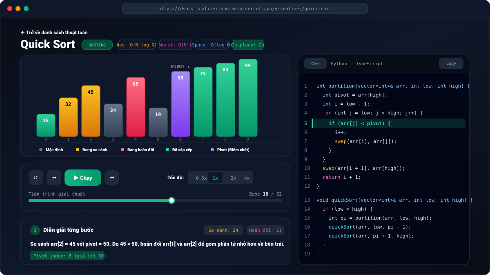

# 🚀 DSA Visualizer – Interactive Algorithm Visualization Web App

<div align="center">


**Một ứng dụng web tương tác trực quan hóa 17 thuật toán Cấu trúc dữ liệu & Giải thuật kinh điển với animation 60 FPS mượt mà, step-by-step, phân tích Big-O thời gian thực và mã nguồn đa ngôn ngữ (C++, Python, TypeScript).**

[🌐 **Trải Nghiệm Live Demo Trên Vercel**](https://dsa-visualizer-one-beta.vercel.app) • [📖 **Xem Báo Cáo Chi Tiết**](#key-takeaways) • [👨‍💻 **Tác Giả**](#author)

</div>

---

<a id="demo"></a>
## 📸 Demo & Giao Diện Ứng Dụng

| Trang Chủ & Bộ Lọc Thuật Toán | Giao Diện Trực Quan Hóa (Visualizer Canvas) |
| :---: | :---: |
| [](https://dsa-visualizer-one-beta.vercel.app) | [](https://dsa-visualizer-one-beta.vercel.app/visualizer/quick-sort) |

---

## 🌟 Tính Năng Nổi Bật (Key Features)

- 📊 **17 Thuật toán được cài đặt hoàn chỉnh**: Bao gồm đầy đủ 6 chủ đề cốt lõi: Sorting, Searching, Graph (BFS/DFS), Array & Dynamic Programming, Tree (BST & AVL Tree), và Pathfinding (Mê cung 2D Dijkstra / A*).
- 🗺️ **Tìm đường đi trong Mê cung 2D (Interactive Pathfinding Grid - Dijkstra & A*)**:
  - Bảng lưới ô vuông 2D trực quan với tương tác kéo chuột vẽ/xóa các bức tường chướng ngại vật (Walls/Obstacles).
  - Tự do kéo thả điểm xuất phát (🟢 Start) và điểm kết thúc (🔴 End) đến bất kỳ vị trí nào trên lưới.
  - Bộ sinh mê cung tích hợp: Tường ngẫu nhiên 30% (Random Walls), Mê cung ziczac (Staircase Maze) và Xóa tường tức thì.
  - Trực quan hóa lan tỏa các ô đã duyệt (Visited wave), hàng đợi mở (Frontier) và đường đi ngắn nhất phát sáng rực rỡ (Golden Shortest Path).
  - Hiển thị phân tích Heuristic thời gian thực: $f(n) = g(n) + h(n)$ với khoảng cách Manhattan cho thuật toán A*.
- 🌳 **Cây nhị phân tìm kiếm & AVL Tree**: Trực quan hóa chèn node (Insert), tìm kiếm (Search), xóa node (Delete) và **4 phép xoay cây tự cân bằng (Single Right LL, Single Left RR, Double LR, Double RL Rotations)** với hiển thị hệ số Balance Factor thời gian thực.
- ⚔️ **Chế độ So Sánh Đối Đầu (Algorithm Race Mode)**: Đặt 2 giải thuật sắp xếp lên cùng một bàn cân chạy đua song song trên cùng mảng dữ liệu (ví dụ: *Quick Sort* vs *Bubble Sort*), hiển thị bảng so sánh đối đầu thời gian thực, đếm số bước, phép so sánh và vinh danh thuật toán chiến thắng 🏆.
- 🎬 **Điều khiển linh hoạt (Interactive Playback)**:
  - Play / Pause (có hỗ trợ phím tắt <kbd>Space</kbd>).
  - Từng bước kế tiếp (<kbd>→</kbd>) hoặc lùi bước (<kbd>←</kbd>).
  - Reset về trạng thái ban đầu (<kbd>R</kbd>).
  - Thanh trượt tiến trình (Progress Scrubber) cho phép tua đến bất kỳ bước nào.
  - Tùy chỉnh tốc độ thực thi: `0.5x`, `1x`, `2x`, `4x`.
- 🎨 **Hệ thống màu sắc trực quan (Color-Coded Status)**:
  - 🟡 **Vàng (Amber)**: Đang so sánh / duyệt phần tử.
  - 🔴 **Đỏ / Hồng (Rose)**: Đang hoán đổi (Swap) hoặc cập nhật giá trị.
  - 🟢 **Xanh lá (Emerald)**: Đã về đúng vị trí sắp xếp / Tìm thấy mục tiêu.
  - 🟣 **Tím (Violet)**: Pivot / Điểm chốt phân hoạch hoặc đỉnh hiện tại.
- 📈 **Số liệu phân tích thời gian thực**:
  - Đếm chính xác số phép so sánh (Comparisons).
  - Đếm số lần hoán đổi (Swaps).
  - Trực quan hóa cấu trúc phụ: Hash Map (Two Sum), Queue (BFS), Call Stack (DFS), Bounding Window (Sliding Window & Kadane).
- 🧩 **Tùy biến dữ liệu đầu vào (Custom Input)**:
  - Sinh mảng ngẫu nhiên (Random Array).
  - Sinh mảng gần như đã sắp xếp (Nearly Sorted).
  - Sinh mảng đảo ngược (Reversed).
  - Nhập mảng tùy chỉnh bất kỳ và giá trị mục tiêu (Target).
- 💻 **Bảng mã nguồn đồng bộ (Synchronized Code Panel)**:
  - Hỗ trợ xem code ở 3 ngôn ngữ: **C++**, **Python**, **TypeScript**.
  - **Highlight dòng code tương ứng** theo từng bước thuật toán đang thực thi.
  - Tính năng copy code tiện lợi.
- 🎵 **Hiệu ứng âm thanh tổng hợp (Web Audio API Synthesizer)**:
  - Tạo âm thanh so sánh và hoán đổi thanh thoát bằng dao động sóng âm thuần túy (không cần file mp3 nặng nề).
  - Hiệu ứng pháo hoa ăn mừng (Confetti) khi thuật toán hoàn thành.
- 🌓 **Hỗ trợ Dark Mode / Light Mode hoàn hảo**: Chuyển đổi giao diện mượt mà với `next-themes`.
- 📱 **Responsive 100%**: Hoạt động tối ưu trên máy tính bảng, điện thoại và màn hình lớn.

---

## 📚 Danh Sách Thuật Toán & Độ Phức Tạp (Supported Algorithms)

### 1. Sorting (Sắp xếp)
| Thuật toán | Best Time | Average Time | Worst Time | Space | Stable | In-Place |
| :--- | :---: | :---: | :---: | :---: | :---: | :---: |
| **Bubble Sort** | $O(N)$ | $O(N^2)$ | $O(N^2)$ | $O(1)$ | ✅ | ✅ |
| **Selection Sort** | $O(N^2)$ | $O(N^2)$ | $O(N^2)$ | $O(1)$ | ❌ | ✅ |
| **Insertion Sort** | $O(N)$ | $O(N^2)$ | $O(N^2)$ | $O(1)$ | ✅ | ✅ |
| **Merge Sort** | $O(N \log N)$ | $O(N \log N)$ | $O(N \log N)$ | $O(N)$ | ✅ | ❌ |
| **Quick Sort** | $O(N \log N)$ | $O(N \log N)$ | $O(N^2)$ | $O(\log N)$ | ❌ | ✅ |
| **Heap Sort** | $O(N \log N)$ | $O(N \log N)$ | $O(N \log N)$ | $O(1)$ | ❌ | ✅ |

### 2. Searching (Tìm kiếm)
| Thuật toán | Best Time | Average Time | Worst Time | Space | Điều kiện |
| :--- | :---: | :---: | :---: | :---: | :--- |
| **Linear Search** | $O(1)$ | $O(N)$ | $O(N)$ | $O(1)$ | Mảng bất kỳ |
| **Binary Search** | $O(1)$ | $O(\log N)$ | $O(\log N)$ | $O(1)$ | Mảng đã sắp xếp |

### 3. Graph (Đồ thị)
| Thuật toán | Time Complexity | Space Complexity | Cấu trúc dữ liệu hỗ trợ | Ứng dụng |
| :--- | :---: | :---: | :--- | :--- |
| **Breadth-First Search (BFS)** | $O(V + E)$ | $O(V)$ | Hàng đợi (Queue) | Tìm đường đi ngắn nhất đồ thị không trọng số |
| **Depth-First Search (DFS)** | $O(V + E)$ | $O(V)$ | Ngăn xếp / Đệ quy (Call Stack) | Duyệt liên thông, tìm chu trình, topo sort |

### 4. Array & Window (Mảng & Quy hoạch động)
| Thuật toán | Time Complexity | Space Complexity | Kỹ thuật cốt lõi |
| :--- | :---: | :---: | :--- |
| **Two Sum** | $O(N)$ | $O(N)$ | Bảng băm (Hash Map lookup trong $O(1)$) |
| **Sliding Window Maximum** | $O(N)$ | $O(k)$ | Cửa sổ trượt (Sliding Window / Monotonic Deque) |
| **Kadane's Algorithm** | $O(N)$ | $O(1)$ | Quy hoạch động tìm Maximum Subarray |

### 5. Tree (Cây nhị phân & AVL tự cân bằng)
| Thuật toán | Best Time | Average Time | Worst Time | Space | Tính năng & Kỹ thuật cốt lõi |
| :--- | :---: | :---: | :---: | :---: | :--- |
| **Binary Search Tree (BST)** | $O(1)$ | $O(\log N)$ | $O(N)$ | $O(N)$ | Chèn, Tìm kiếm, Xóa node 2 con (Inorder Successor) |
| **AVL Tree (Self-Balancing)** | $O(1)$ | $O(\log N)$ | $O(\log N)$ | $O(N)$ | Tự cân bằng với 4 phép xoay: LL, RR, LR, RL ($BF \in \{-1, 0, 1\}$) |

### 6. Pathfinding (Tìm đường trong Mê cung 2D)
| Thuật toán | Best Time | Average Time | Worst Time | Space | Kỹ thuật & Tương tác |
| :--- | :---: | :---: | :---: | :---: | :--- |
| **Dijkstra's Algorithm (2D Grid)** | $O(V + E \log V)$ | $O(E + V \log V)$ | $O(E + V \log V)$ | $O(V)$ | Tìm đường ngắn nhất kinh điển với Min-Heap/Priority Queue, lan tỏa tròn |
| **A\* Search Algorithm (2D Grid)** | $O(V)$ | $O(E)$ | $O(b^d)$ | $O(V)$ | Tìm đường Heuristic tối ưu $f(n) = g(n) + h(n)$ (Khoảng cách Manhattan) hướng đích |

---

## 🛠️ Tech Stack & Kiến Trúc Kỹ Thuật

| Công nghệ | Phiên bản | Vai trò trong dự án |
| :--- | :--- | :--- |
| **Next.js** | **v15 (App Router)** | Framework nền tảng, Server/Client components tối ưu, Static Site Generation (SSG) với `generateStaticParams`. |
| **React** | **v19** | Thư viện UI hiện đại với các hooks tối ưu hiệu năng (`useCallback`, `useMemo`). |
| **TypeScript** | **v5 (Strict)** | Đảm bảo type safety 100%, kiểm soát chặt chẽ schema dữ liệu của `Step`, `Algorithm`, `GraphData`. |
| **Tailwind CSS** | **v3.4** | Hệ thống utility-first styling, cấu hình Dark Mode chuẩn với class strategy. |
| **Framer Motion** | **v12** | Đảm nhiệm animation chuyển động các cột (layout animations), spring transitions và UI gestures mượt mà. |
| **Web Audio API** | Native Browser | Bộ tổng hợp dao động âm thanh (Sine & Triangle oscillators) không cần tải asset ngoài. |
| **Lucide React** | Latest | Bộ icon tối giản, hiện đại và đồng bộ. |
| **next-themes** | Latest | Quản lý theme Dark / Light không bị hydration mismatch. |

---

## 📁 Cấu Trúc Thư Mục Dự Án

```
dsa-visualizer/
├── app/
│   ├── favicon.ico
│   ├── globals.css                       # Biến CSS, font và scrollbar
│   ├── icon.tsx                          # Favicon dynamic sinh bởi ImageResponse
│   ├── layout.tsx                        # Root layout với Navbar, Footer, ThemeProvider
│   ├── page.tsx                          # Trang chủ: Hero, Bộ lọc category, Gallery thẻ thuật toán
│   └── visualizer/
│       └── [algorithm]/
│           ├── page.tsx                  # Server Component pre-render SSG
│           └── VisualizerClient.tsx      # Client Component điều khiển logic animation
├── components/
│   ├── AlgorithmCard.tsx                 # Card thuật toán trang chủ
│   ├── CodePanel.tsx                     # Bảng code C++, Python, TS đồng bộ dòng thực thi
│   ├── ComplexityBadge.tsx               # Huy hiệu trực quan hóa độ phức tạp Big-O
│   ├── ControlPanel.tsx                  # Bộ điều khiển Play/Pause, Tốc độ, Thanh tua, Custom mảng
│   ├── Footer.tsx                        # Chân trang thông tin tác giả và bản quyền
│   ├── Navbar.tsx                        # Thanh điều hướng, Dark mode toggle, GitHub link
│   ├── StepDescription.tsx              # Hộp mô tả bước đi và số liệu so sánh/hoán đổi
│   ├── ThemeProvider.tsx                 # Wrapper của next-themes
│   ├── ThemeToggle.tsx                   # Nút chuyển giao diện Sáng / Tối
│   └── VisualizerCanvas.tsx              # Canvas vẽ biểu đồ cột (Array) và đồ thị SVG (Graph)
├── lib/
│   ├── algorithms/
│   │   ├── array.ts                      # Two Sum, Sliding Window, Kadane
│   │   ├── graph.ts                      # BFS, DFS và Graph Canvas model
│   │   ├── index.ts                      # Đăng ký danh sách 13 thuật toán, metadata & code
│   │   ├── searching.ts                  # Linear Search, Binary Search
│   │   └── sorting.ts                    # Bubble, Selection, Insertion, Merge, Quick, Heap Sort
│   ├── types.ts                          # Khai báo TypeScript types chuẩn chỉnh
│   └── utils.ts                          # Bộ sinh mảng ngẫu nhiên, synthesizer âm thanh, cn helper
├── public/                               # Static assets
├── package.json
├── tailwind.config.ts
├── tsconfig.json
└── README.md
```

---

## 💻 Hướng Dẫn Cài Đặt & Chạy Local

### Yêu cầu tiên quyết:
- Đã cài đặt **Node.js 18.18+** hoặc **Node.js 20/22 LTS**.
- Trình quản lý gói `npm`, `pnpm` hoặc `yarn`.

### Các bước thực hiện:

1. **Clone repository về máy**:
   ```bash
   git clone https://github.com/vuloc080611/DSA-Visualizer.git
   cd DSA-Visualizer
   ```

2. **Cài đặt các thư viện phụ thuộc**:
   ```bash
   npm install
   ```

3. **Khởi chạy môi trường phát triển (Development Server)**:
   ```bash
   npm run dev
   ```

4. **Mở trình duyệt và trải nghiệm**:
   Truy cập địa chỉ [http://localhost:3000](http://localhost:3000) trên trình duyệt của bạn.

5. **Kiểm tra build production**:
   ```bash
   npm run build
   npm start
   ```

---

<a id="key-takeaways"></a>
## 💡 Những Gì Học Được (Key Takeaways)

Quá trình xây dựng dự án này mang lại nhiều kiến thức chuyên sâu và kinh nghiệm thực chiến quý báu:

1. **Tư duy thiết kế Pure Function & Snapshot State**:
   - Thay vì nhúng các hàm `setTimeout` hay `sleep` trực tiếp trong vòng lặp giải thuật (rất dễ gây race condition và khó tua ngược), toàn bộ các thuật toán được thiết kế thành **Pure Function** nhận đầu vào và trả về mảng các snapshot `Step[]`.
   - Mô hình này cho phép người dùng **tua tới (Next), tua lùi (Prev), nhảy đến bất kỳ bước nào (Scrubbing)** một cách tức thì mà không bao giờ bị lệch trạng thái.

2. **Làm chủ Next.js 15 App Router & React 19**:
   - Tách bạch ranh giới Server Components (`generateStaticParams`, `generateMetadata` chuẩn SEO) và Client Components tương tác cao (`VisualizerClient`).
   - Xử lý mượt mà hydration, dynamic favicon bằng `next/og` và dark mode không bị flickering.

3. **Animation 60 FPS với Framer Motion**:
   - Áp dụng kỹ thuật `layout` prop của Framer Motion để các cột số khi hoán đổi vị trí (swap) tự động lướt qua nhau mượt mà với spring physics.
   - Trực quan hóa cấu trúc đồ thị động bằng SVG tương tác, xử lý màu sắc và đường nét chuyển động theo từng tầng duyệt.

4. **Kỹ thuật âm thanh thời gian thực với Web Audio API**:
   - Tự tạo các Oscillator sóng Sine và Triangle để phát tiếng "beep" nhẹ khi so sánh và âm trầm bổng khi hoán đổi mà không cần tải bất kỳ tệp audio bên ngoài nào, giúp website tải siêu nhanh.

---

<a id="author"></a>
## 👨‍💻 Tác Giả

- **Họ và tên:** **Vũ Lộc**
- **Vị trí:** Sinh viên năm 3 – Chuyên ngành Công nghệ Thông tin (CNTT)
- **Trường:** Trường Đại học Công nghiệp TP.HCM (IUH)
- **Mục tiêu:** Ứng tuyển vị trí Thực tập sinh Frontend / Full-stack Developer (Internship)
- **GitHub:** [github.com/vuloc080611](https://github.com/vuloc080611)
- **Repository:** [github.com/vuloc080611/DSA-Visualizer](https://github.com/vuloc080611/DSA-Visualizer)

---

<div align="center">
  <sub>⭐ Nếu bạn thấy dự án hữu ích hoặc thú vị, hãy tặng 1 Star trên GitHub nhé! Cảm ơn bạn rất nhiều! ⭐</sub>
</div>
